# Attendly

**A full-stack student attendance management system for schools and colleges.**

Mark a full class in seconds, spot at-risk students before they fall behind, and export clean attendance reports — from one responsive workspace.

Built with **React**, **Node.js/Express**, and **MongoDB**, and packaged for a one-step **Render** deployment.

[Features](#features) · [Screenshots](#screenshots) · [Getting started](#getting-started) · [API reference](#api-reference) · [Deployment](#deployment-on-render)


---

## Overview

Attendly is a complete attendance workflow for a teaching team:

- **Admins** manage the academic structure (classes, subjects, students, staff) and can review every report.
- **Teachers** open a daily register, mark exceptions with one tap, and review class performance.
- Attendance is stored as **one sheet per class + subject + day**, so re-opening a date shows the saved register and re-saving updates it instead of creating duplicates.

The app is intentionally dependency-light: React + React Router + Axios on the frontend, Express + Mongoose on the backend, and a hand-written CSS design system. No UI kit, no chart library, no state-management framework.

**Highlights**

- Two role-aware experiences from one codebase
- One-tap attendance with `present`, `absent`, `late`, and `excused`
- Dashboards with 7-day trends, class breakdowns, and a low-attendance watchlist
- Date-range reports with per-student percentages and CSV export
- First-run administrator setup, then invite-only account creation
- Production build served by Express as a single Render web service

---

## Screenshots

Screenshots were captured from the seeded demo dataset at 1440 px and 390 px widths.

| Sign in | Dashboard |
| :---: | :---: |
| 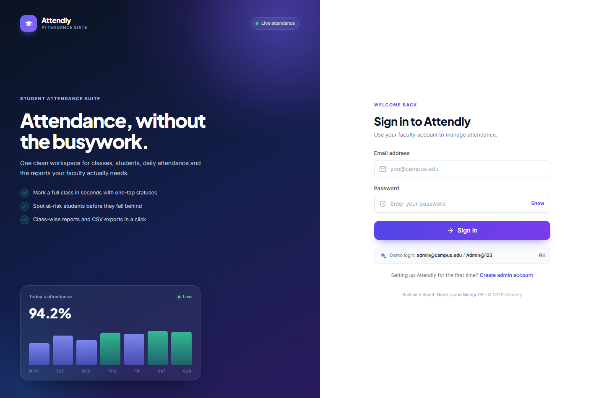 | 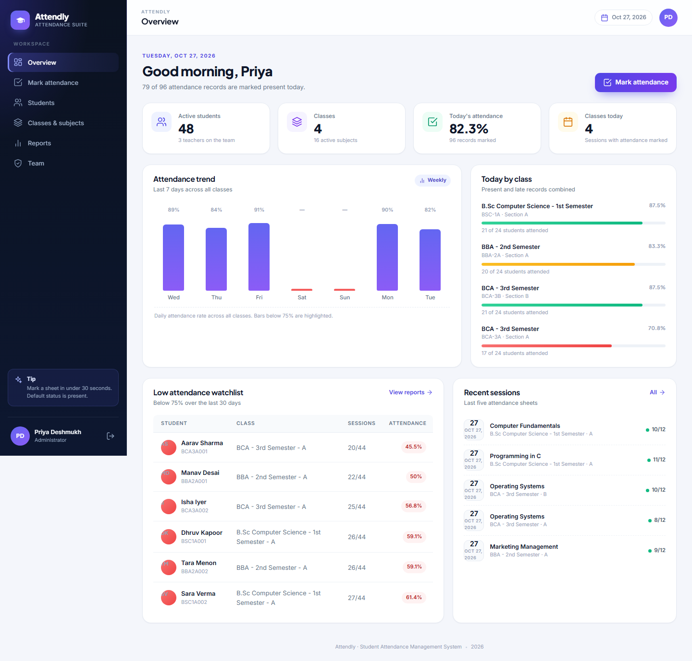 |

| Students | Mark attendance |
| :---: | :---: |
| 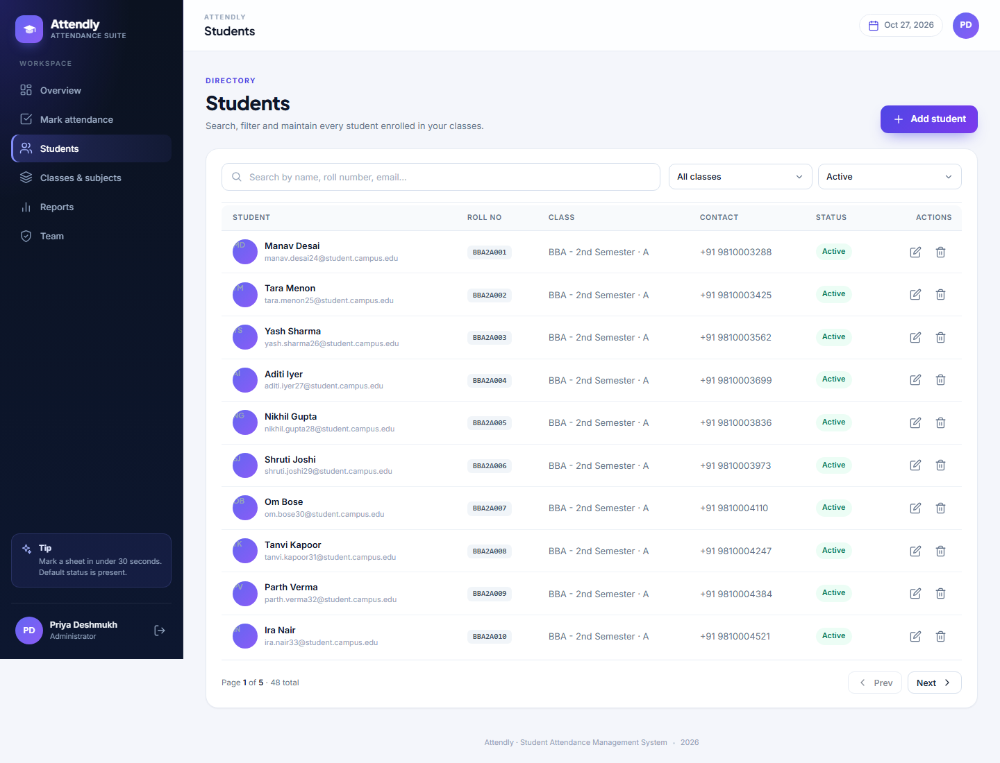 | 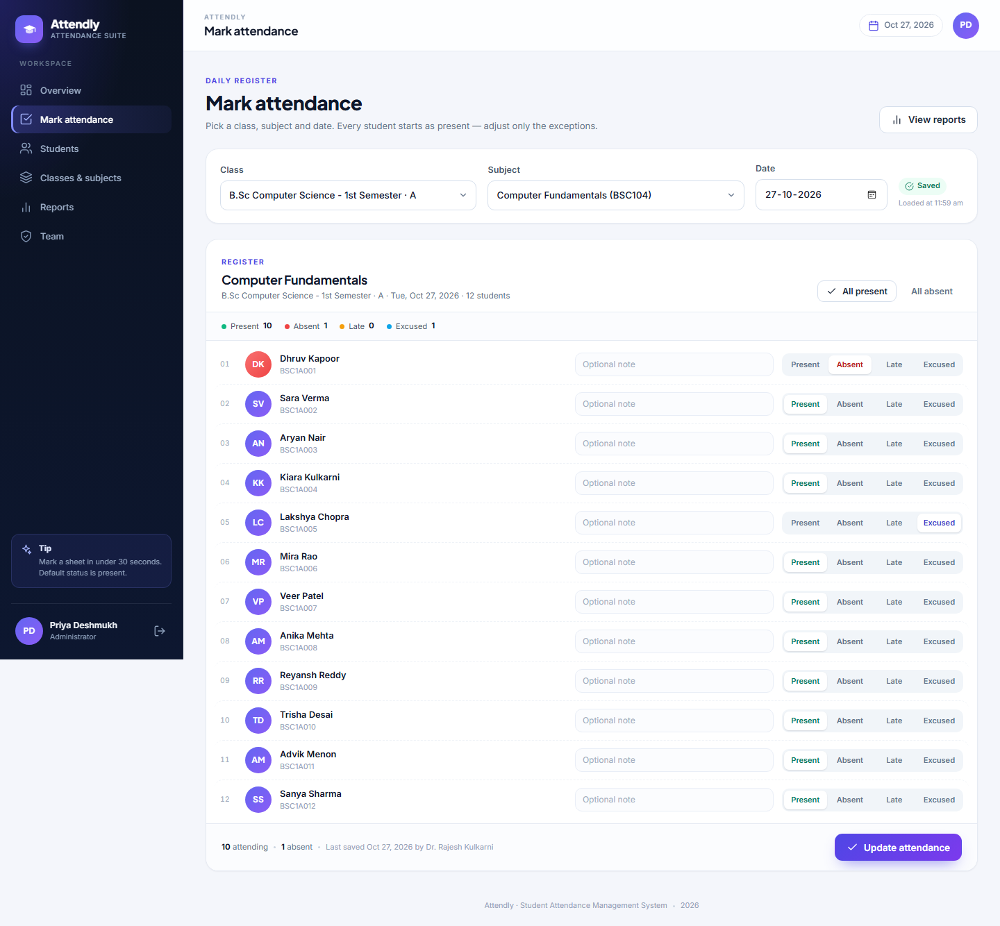 |

| Reports | Classes & subjects |
| :---: | :---: |
| 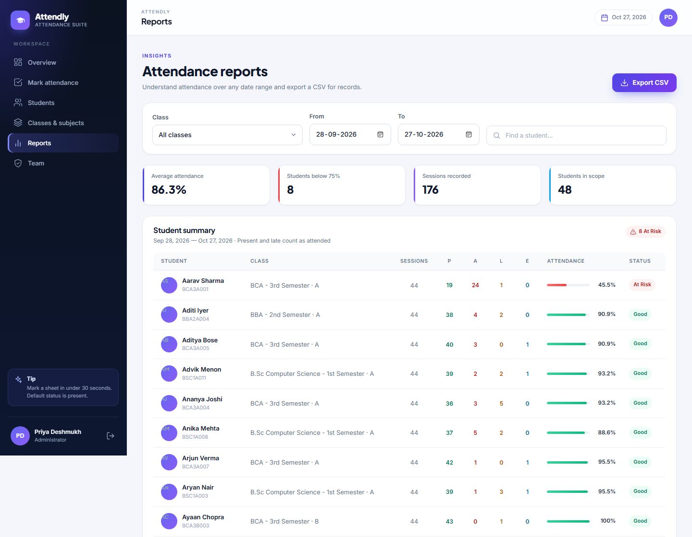 | 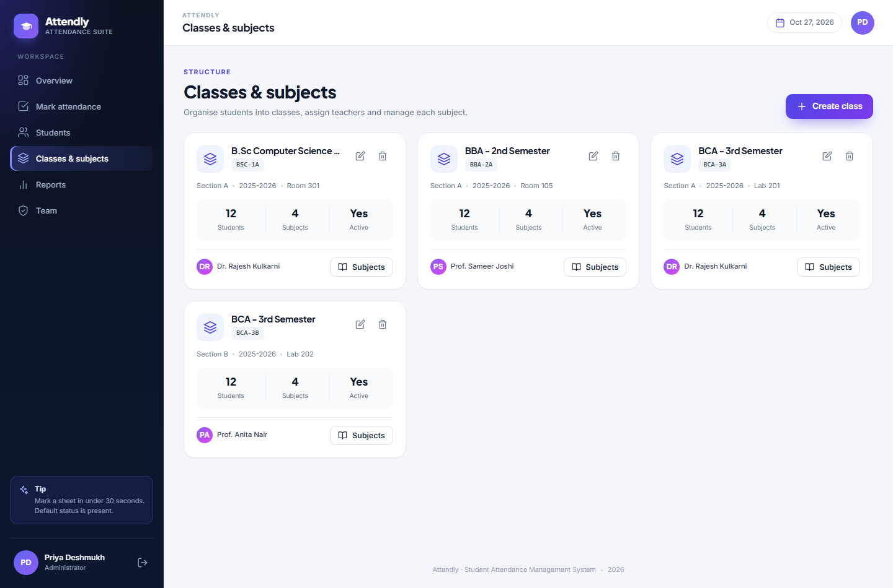 |

<details>
<summary><strong>More screenshots: team, mobile, modals, and the teacher view</strong></summary>

<br>

| Team | Profile |
| :---: | :---: |
| 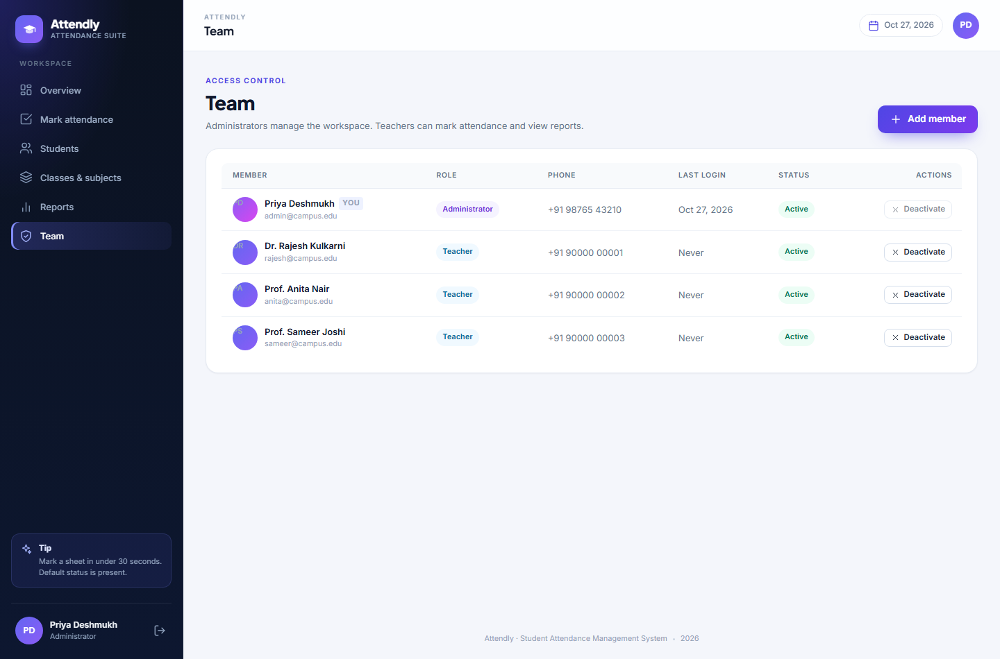 | 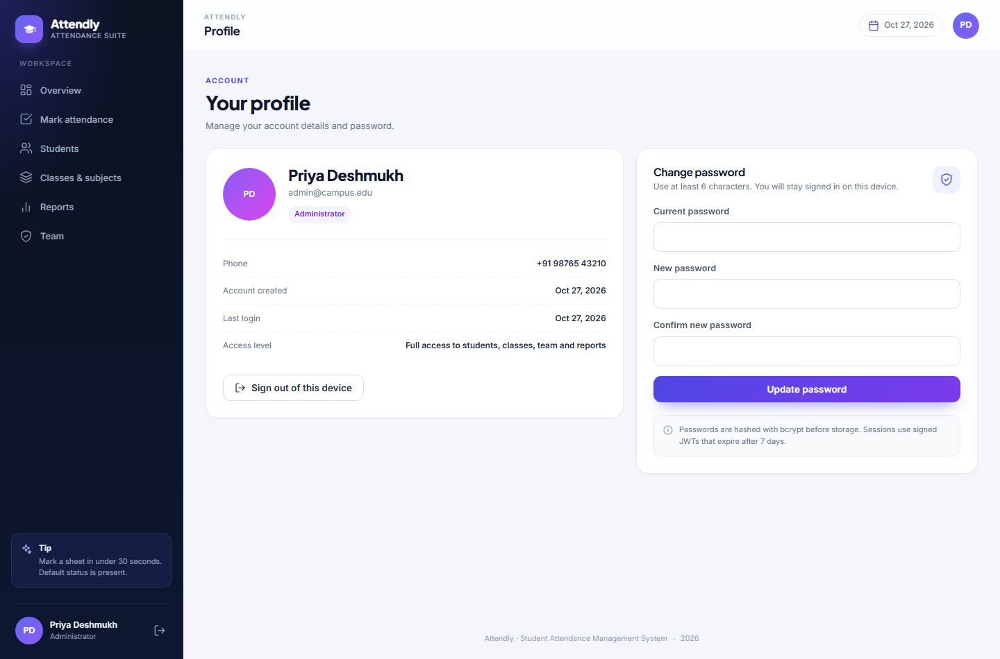 |

| Add student | Manage subjects |
| :---: | :---: |
| 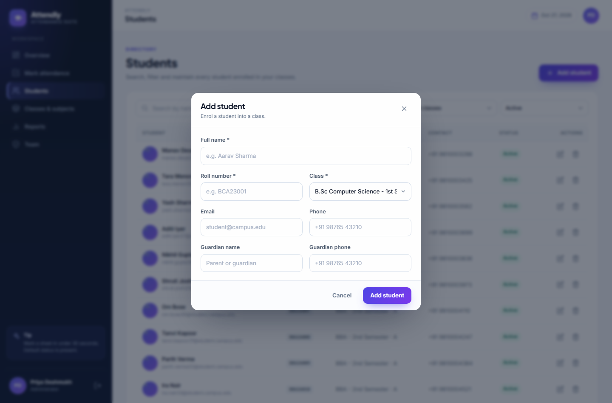 | 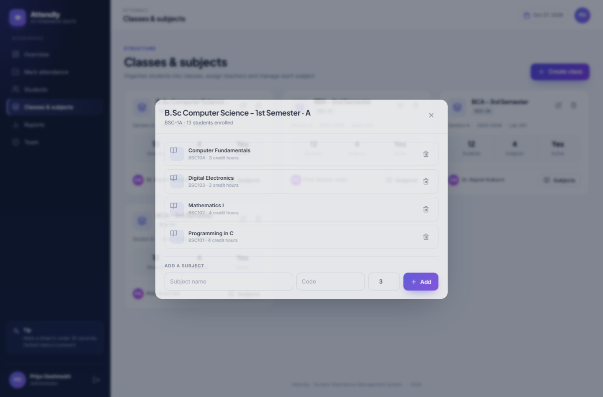 |

| Add team member | Teacher dashboard |
| :---: | :---: |
| 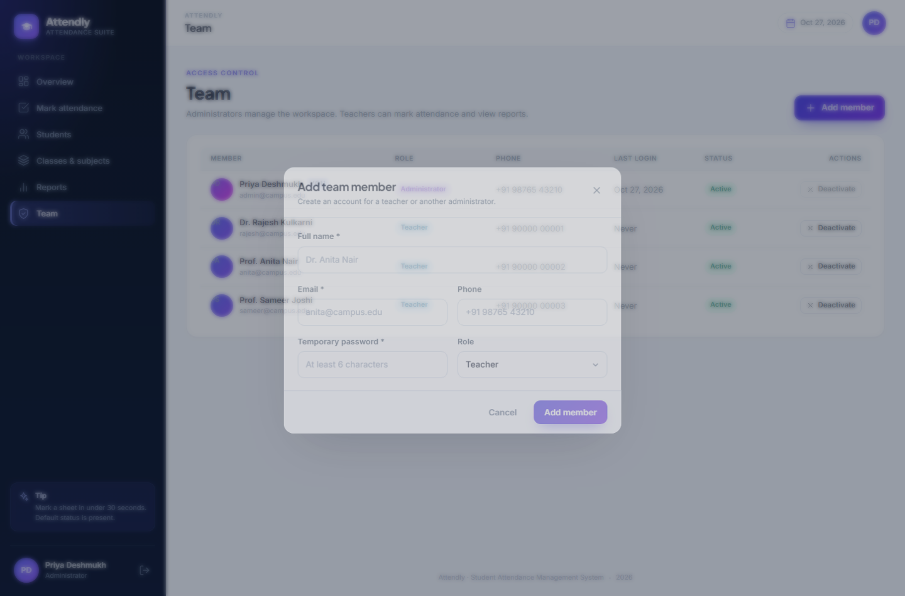 | 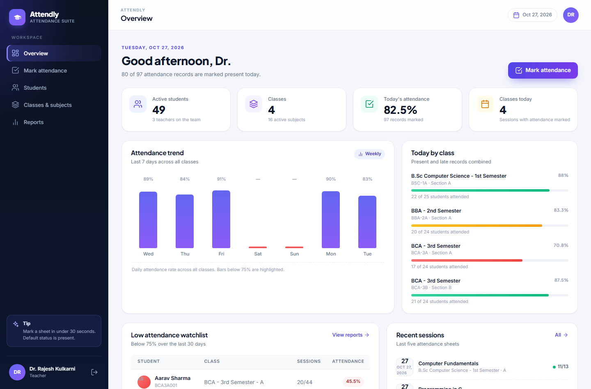 |

| Mobile dashboard | Mobile attendance | Mobile students |
| :---: | :---: | :---: |
| 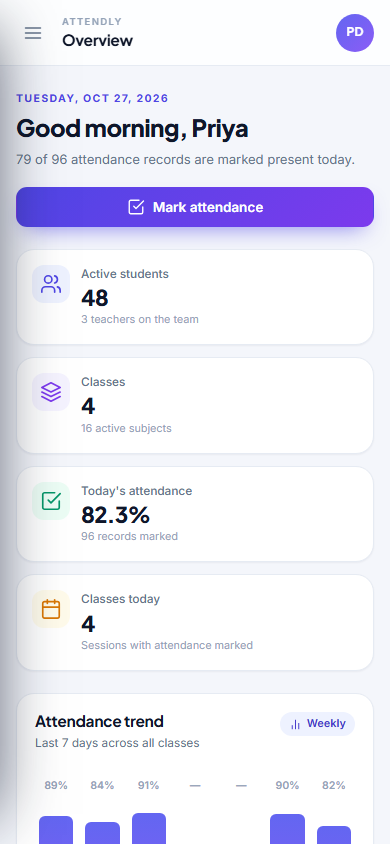 | 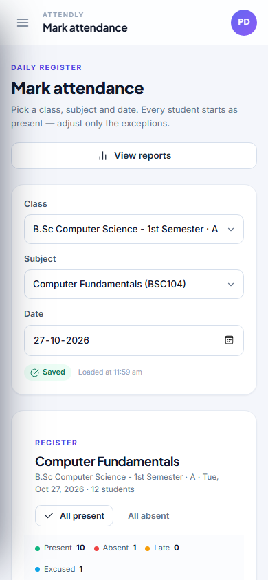 | 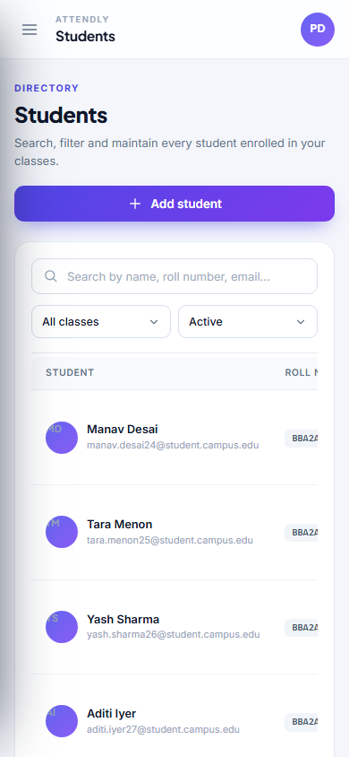 |

</details>

---

## Features

### Attendance workflow

- Pick a class, subject, and date; the active roster loads automatically.
- Every student starts as **present**, so only exceptions need a tap.
- Four statuses: `present`, `absent`, `late`, and `excused`, with an optional per-student remark.
- **All present** / **All absent** bulk actions.
- Saving is an upsert keyed by class + subject + date — re-opening a day restores the saved sheet and re-saving updates it.
- Live counts and a "saved at" indicator confirm the write.
- Race-condition guard prevents a slow request for an old class/subject from overwriting the current register.

### Insights and reporting

- Today's attendance percentage, active students, classes, subjects, and team size.
- Seven-day attendance trend, with empty days shown as gaps instead of misleading zero bars.
- Per-class attendance breakdown for the selected day.
- Low-attendance watchlist (under 75% over the last 30 days, minimum five sessions).
- Recent attendance sheets with marker and counts.
- Reports can be filtered by class and date range, searched by student, and exported to CSV.
- Student drawer shows individual session history with dates, subjects, and statuses.

### Administration

- Full CRUD for students, classes, and subjects.
- Subject management per class, including credit hours and teacher assignment.
- Class-level student and subject counts.
- Safe deletes: a class with students cannot be deleted; a subject with attendance history can be deactivated instead.
- Team management for admins: create admins or teachers, edit details, reset passwords, deactivate, or remove accounts.
- Self-protection rules prevent admins from removing their own role, deleting themselves, or deactivating their own account.
- Students can be deactivated without losing their historical attendance.

### Accounts and security

- JWT authentication with a seven-day expiry by default.
- Passwords hashed with bcrypt (12 rounds) and never returned by the API.
- Role-based access control (`admin` / `teacher`) enforced on the server, not just hidden in the UI.
- First registered account becomes the administrator; after that, public registration is closed.
- Rate limiting on login/registration, Helmet security headers, and an explicit CORS allowlist.
- Users can update their name/phone and change their password from the profile screen.

### UX and quality

- Responsive layout from 390 px phones to wide desktops.
- Toast notifications, inline validation, loading states, and empty states.
- Keyboard-friendly modals with focus handling and Escape-to-close.
- No console errors in the verified flows.
- 9 backend integration tests covering auth, roles, CRUD, attendance, reports, and CSV export.

---

## Tech stack

| Layer | Technology | Notes |
| --- | --- | --- |
| Frontend | React 18, Vite 5, React Router 6 | Fast dev server, client-side routing |
| HTTP client | Axios | Shared instance, JWT interceptor, 401 handling |
| Styling | Custom CSS design system | No UI library; tokens, responsive grid, dark sidebar |
| Charts | Hand-built CSS bars | Keeps the production bundle small |
| Backend | Node.js 20+, Express 4 | ESM modules, layered controllers/routes |
| Database | MongoDB 8 with Mongoose 8 | Schema validation, indexes, aggregation pipelines |
| Auth | jsonwebtoken, bcryptjs | Bearer tokens, hashed passwords |
| Security | Helmet, CORS, express-rate-limit | Headers, allowlist, auth throttling |
| Tests | Node test runner, Supertest, mongodb-memory-server | Isolated in-memory MongoDB per run |
| Deployment | Render (single web service) | Express serves both `/api` and the React build |

**Production bundle:** roughly 286 KB JavaScript and 40 KB CSS before gzip (90 KB / 8.6 KB gzipped).

---

## Architecture

Attendly is deployed as **one Render web service**. Express exposes the REST API under `/api` and, when `client/dist` exists, serves the compiled React SPA for every other route. This keeps the deployment simple: one URL, same-origin API calls, no CORS configuration for the default setup.

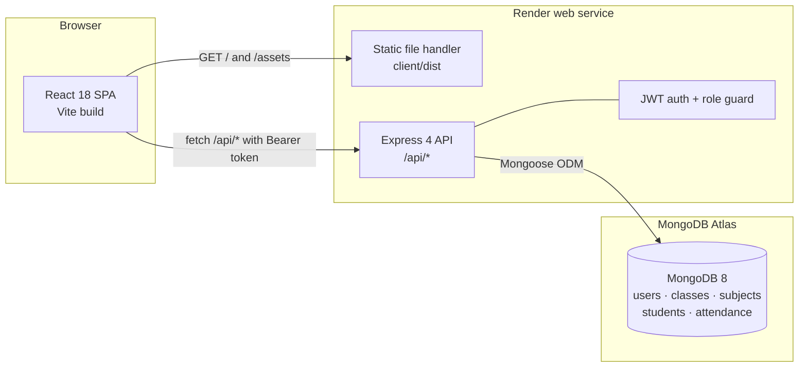

**Request flow**

1. The browser loads the SPA from Express (or from Vite during development).
2. The SPA calls `/api/*` with `Authorization: Bearer <token>`.
3. Express verifies the JWT, checks the role guard, and runs the controller.
4. Mongoose validates the request against the schema and persists it to MongoDB.
5. Responses use a consistent `{ success, data, meta? }` envelope; errors return `{ success: false, message }`.

**Why a single service?**

- Same-origin requests mean no CORS preflight in the default deployment.
- One URL to share, one service to monitor, one free Render instance.
- The SPA fallback handles deep links such as `/students` and `/reports` on refresh.
- Split deployment is still supported if you prefer a CDN-hosted frontend (see [Split deployment](#split-deployment-optional)).

---

## Data model

Five collections, with attendance records embedded inside each daily sheet.

```mermaid
erDiagram
    USER |o--o{ CLASS : "homeroom teacher"
    USER |o--o{ SUBJECT : "subject teacher"
    USER |o--o{ ATTENDANCE : "marked by"
    CLASS ||--o{ SUBJECT : "offers"
    CLASS ||--o{ STUDENT : "enrols"
    CLASS ||--o{ ATTENDANCE : "session"
    SUBJECT ||--o{ ATTENDANCE : "session"
    ATTENDANCE ||--|{ ATTENDANCE_RECORD : "embeds"
    STUDENT ||--o{ ATTENDANCE_RECORD : "appears in"

    USER {
        ObjectId _id
        string name
        string email "unique"
        string password "bcrypt hash"
        string role "admin or teacher"
        string phone
        boolean isActive
        date lastLoginAt
    }

    CLASS {
        ObjectId _id
        string name
        string code "unique"
        string section
        string academicYear
        string room
        ObjectId teacher "User"
        boolean isActive
    }

    SUBJECT {
        ObjectId _id
        string name
        string code
        ObjectId class "Class"
        ObjectId teacher "User"
        number creditHours
        boolean isActive
    }

    STUDENT {
        ObjectId _id
        string name
        string rollNo "unique"
        string email
        string phone
        ObjectId class "Class"
        string guardianName
        string guardianPhone
        date admissionDate
        string status "active or inactive"
    }

    ATTENDANCE {
        ObjectId _id
        ObjectId class "Class"
        ObjectId subject "Subject"
        date date "UTC midnight"
        ObjectId markedBy "User"
    }

    ATTENDANCE_RECORD {
        ObjectId student "Student"
        string status "present, absent, late, excused"
        string remark
    }
```

**Indexes and invariants**

| Collection | Index / rule | Purpose |
| --- | --- | --- |
| `users` | unique `email` | One account per email |
| `classes` | unique `code` | Stable class identifier |
| `subjects` | unique `(class, code)` | Same subject code can exist in different classes |
| `students` | unique `rollNo`, index `(name)`, index `(class)` | Fast lookup and roster queries |
| `attendance` | unique `(class, subject, date)` | One sheet per class/subject/day; enables safe upsert |

**Calendar dates:** attendance is tracked per calendar day. Dates are normalized to **00:00 UTC** before storage, and the API accepts and returns `YYYY-MM-DD` keys. This avoids timezone drift between the browser and the server.

**Referential cleanup**

- Deleting a student removes their embedded records and deletes any sheets left empty.
- Deleting a class is blocked while it has students; otherwise its subjects and attendance sheets are removed.
- Deleting a subject is blocked when attendance history exists; deactivate it instead.
- Removing a team member detaches them from classes and subjects (historical `markedBy` references remain harmless).

---

## Project structure

```text
attendly/
├── client/                      # React SPA (Vite)
│   ├── public/
│   │   └── _redirects           # Netlify SPA fallback for split deployment
│   ├── src/
│   │   ├── api/client.js        # Axios instance, JWT interceptor, error helper
│   │   ├── components/          # Layout, modal, table, chart, guards, toasts
│   │   ├── context/             # Auth and toast providers
│   │   ├── pages/               # Login, Dashboard, Students, Classes, Attendance,
│   │   │                        # Reports, Team, Profile, NotFound
│   │   ├── utils/format.js      # Dates, initials, percentages
│   │   ├── App.jsx              # Route tree and role guards
│   │   ├── main.jsx
│   │   └── styles.css           # Design tokens and all component styles
│   ├── .env.example
│   ├── vercel.json              # Vercel SPA rewrite for split deployment
│   └── vite.config.js           # Dev server + /api proxy
│
├── server/                      # Express API
│   ├── scripts/dev-mongo.mjs    # Optional in-memory MongoDB for local dev
│   ├── src/
│   │   ├── config/db.js         # Mongoose connection
│   │   ├── controllers/         # auth, students, classes, subjects, attendance,
│   │   │                        # dashboard, users
│   │   ├── middleware/          # JWT guard, role guard, error handler
│   │   ├── models/              # User, Class, Subject, Student, Attendance
│   │   ├── routes/              # /api route tree
│   │   ├── utils/               # ApiError, async handler, dates, tokens, validation
│   │   ├── app.js               # Express app, CORS, static SPA, error handling
│   │   ├── seed.js              # Demo data seeder
│   │   └── server.js            # HTTP server + graceful shutdown
│   ├── tests/api.test.js        # Integration tests
│   └── .env.example
│
├── docs/screenshots/            # README images
├── render.yaml                  # Render Blueprint (single web service)
├── package.json                 # Convenience scripts for the monorepo
├── .gitignore
└── README.md
```

---

## Getting started

### Prerequisites

- **Node.js 20 or newer** (Node 22 LTS recommended)
- **npm 9 or newer**
- **MongoDB 7/8** running locally, a free **MongoDB Atlas** cluster, or the bundled in-memory dev database (no install required)
- Git (only needed to clone/deploy)

> **Windows PowerShell:** if `npm` is blocked by the execution policy (`npm.ps1 cannot be loaded`), use `npm.cmd` for every command in this guide, or run `Set-ExecutionPolicy -Scope CurrentUser RemoteSigned` once.

### Quick start

```bash
git clone <your-repository-url> attendly
cd attendly
npm run setup
```

Then configure the server environment, start a database, seed demo data, and run both processes:

```bash
# 1. Create the server env file
cp server/.env.example server/.env        # macOS/Linux
# Copy-Item server/.env.example server/.env   # Windows PowerShell

# 2. Edit server/.env and set MONGODB_URI + JWT_SECRET

# Terminal 1 — optional in-memory database (skip if using MongoDB/Atlas)
npm run dev:db

# Terminal 2 — seed once
npm run seed:force

# Terminal 3 — API
npm run dev:server

# Terminal 4 — Vite dev server
npm run dev:client
```

Open **http://localhost:5173**. The API runs on **http://localhost:5000**, and Vite proxies `/api` to it.

### 1. Install dependencies

From the repository root:

```bash
npm run setup
```

This is equivalent to:

```bash
npm --prefix server install
npm --prefix client install
```

The root `package.json` has no runtime dependencies; it only provides convenience scripts.

### 2. Configure the server

Create `server/.env` from the example:

```bash
cp server/.env.example server/.env
```

```env
NODE_ENV=development
PORT=5000

# Local MongoDB
MONGODB_URI=mongodb://127.0.0.1:27017/attendance

# Use a long random value in every environment
JWT_SECRET=replace-this-with-a-long-random-string
JWT_EXPIRES_IN=7d

# Only needed for a separately hosted frontend
CLIENT_URL=http://localhost:5173
```

Generate a strong secret:

```bash
node -e "console.log(require('crypto').randomBytes(48).toString('hex'))"
```

**Environment notes**

- `CLIENT_URL` accepts a comma-separated list of origins.
- Same-origin requests are always allowed, so you can leave `CLIENT_URL` empty in the single-service deployment.
- `RENDER_EXTERNAL_URL` is injected automatically by Render and is also accepted as an allowed origin.
- The server reads `.env` through `dotenv` when it starts.

### 3. Point the app at a database

**Option A — local MongoDB**

```env
MONGODB_URI=mongodb://127.0.0.1:27017/attendance
```

Start `mongod` (or the MongoDB service/container) before the API. The database and collections are created automatically.

**Option B — MongoDB Atlas**

1. Create a free **M0** cluster at [mongodb.com/atlas](https://www.mongodb.com/atlas).
2. Add a database user under **Database Access**.
3. Allow your IP under **Network Access**. For a Render deployment, `0.0.0.0/0` is the simplest starting point because free Render services do not have static outbound IPs.
4. Copy the driver connection string and add the database name:

```env
MONGODB_URI=mongodb+srv://<user>:<password>@<cluster>.mongodb.net/attendly?retryWrites=true&w=majority
```

URL-encode special characters in the password (for example, `@` becomes `%40`).

**Option C — bundled in-memory MongoDB (zero install)**

If you do not have MongoDB installed, start the included in-memory server:

```bash
npm run dev:db
```

It listens on `127.0.0.1:27017`, which matches the default `MONGODB_URI`. Keep the terminal open while you work. The data is held in memory and disappears when the process stops, so this mode is for demos and local development only. Seed it in another terminal with `npm run seed:force`.

### 4. Seed demo data (optional)

```bash
# Seed only when the database has no users
npm run seed

# Wipe users, classes, subjects, students, and attendance, then re-seed
npm run seed:force
```

The seeder creates 4 classes, 16 subjects, 48 students, 3 teachers, 1 admin, and roughly six weeks of weekday attendance — including a few intentionally at-risk students so the dashboard and reports have something to show.

> `seed:force` is destructive. Never run it against a database with real data.

### 5. Run locally

```bash
# Terminal 1 — API with Node's watch mode
npm run dev:server

# Terminal 2 — Vite dev server
npm run dev:client
```

| Service | URL |
| --- | --- |
| React app | http://localhost:5173 |
| API | http://localhost:5000 |
| Health check | http://localhost:5000/api/health |

### 6. First-run administrator

If the database has no users (for example, after connecting a fresh Atlas cluster without seeding):

1. Open the app and choose **Create admin account** on the login screen.
2. The first account is created as an `admin`.
3. Public registration then closes automatically.
4. Admins create all further accounts from **Team**.

### Demo accounts

These accounts exist after running the seeder:

| Role | Email | Password |
| --- | --- | --- |
| Administrator | `admin@campus.edu` | `Admin@123` |
| Teacher | `rajesh@campus.edu` | `Teacher@123` |
| Teacher | `anita@campus.edu` | `Teacher@123` |
| Teacher | `sameer@campus.edu` | `Teacher@123` |

Change these credentials before exposing a seeded deployment publicly.

---

## Scripts

### Root scripts

| Command | Description |
| --- | --- |
| `npm run setup` | Install server and client dependencies |
| `npm run dev:db` | Start the optional in-memory MongoDB on port 27017 |
| `npm run dev:server` | Start the API with `node --watch` |
| `npm run dev:client` | Start the Vite dev server |
| `npm run build` | Build the React app into `client/dist` |
| `npm start` | Start the production API (serves the SPA if built) |
| `npm run seed` | Seed demo data only if the database is empty |
| `npm run seed:force` | Reset and re-seed the demo data |
| `npm test` | Run the backend integration tests |

### Package-level scripts

| Package | Command | Description |
| --- | --- | --- |
| `server` | `npm start` | `node src/server.js` |
| `server` | `npm run dev` | `node --watch src/server.js` |
| `server` | `npm run dev:db` | In-memory MongoDB for local development |
| `server` | `npm run seed` | Run the seeder |
| `server` | `npm test` | Node test runner, serially |
| `client` | `npm run dev` | Vite dev server on port 5173 |
| `client` | `npm run build` | Production build to `client/dist` |
| `client` | `npm run preview` | Preview the production build |

---

## Environment variables

### Server (`server/.env`)

| Variable | Required | Default | Description |
| --- | --- | --- | --- |
| `NODE_ENV` | No | `development` | Enables production logging and disables test-only behavior |
| `PORT` | No | `5000` | HTTP port (Render sets this automatically) |
| `MONGODB_URI` | **Yes** | — | MongoDB local or Atlas connection string |
| `JWT_SECRET` | **Yes** | — | Secret used to sign access tokens |
| `JWT_EXPIRES_IN` | No | `7d` | Token lifetime (any `jsonwebtoken` duration) |
| `CLIENT_URL` | No | — | Comma-separated allowed frontend origins for split deployments |
| `RENDER_EXTERNAL_URL` | No | — | Injected by Render; automatically added to the CORS allowlist |

### Client (`client/.env`, optional)

| Variable | Required | Default | Description |
| --- | --- | --- | --- |
| `VITE_API_URL` | No | `/api` (relative) | API origin **without** `/api`; used for split deployments. Read at build time. |
| `VITE_DEV_API_URL` | No | `http://localhost:5000` | Vite dev proxy target |

Examples:

```env
# Same origin (single-service deployment)
VITE_API_URL=

# Split deployment
VITE_API_URL=https://attendly-api.onrender.com
```

Because Vite inlines environment variables at build time, rebuild the frontend after changing `VITE_API_URL`.

---

## API reference

**Base URL:** `/api` (for example, `http://localhost:5000/api`)

**Conventions**

- Authenticated requests send `Authorization: Bearer <token>`.
- Request and response bodies are JSON.
- Dates use `YYYY-MM-DD`; timestamps are ISO 8601.
- Paginated endpoints accept `page` (default `1`) and `limit` (default `20`, max `100`) and return `meta: { page, limit, total, pages }`.
- Date-range endpoints accept `from` and `to`; when omitted, the default range is the **last 30 days**.
- Errors use the same envelope with a human-readable message.

```json
{
  "success": true,
  "data": {},
  "meta": {}
}
```

```json
{
  "success": false,
  "message": "Incorrect email or password"
}
```

**Access levels**

- **Public** — no token required.
- **Authenticated** — any active admin or teacher.
- **Admin** — authenticated user with the `admin` role.

### Health

| Method | Endpoint | Access | Description |
| --- | --- | --- | --- |
| `GET` | `/health` | Public | Liveness check used by Render |

### Authentication

| Method | Endpoint | Access | Description |
| --- | --- | --- | --- |
| `POST` | `/auth/register` | Public* | Create the first administrator; blocked once any user exists |
| `POST` | `/auth/login` | Public | Exchange email/password for a JWT |
| `GET` | `/auth/me` | Authenticated | Return the current user |
| `PUT` | `/auth/password` | Authenticated | Change the current user's password |

\* First-run only. The endpoint returns `403` after the first account exists.

<details>
<summary>Request and response examples</summary>

<br>

**Login**

```http
POST /api/auth/login
Content-Type: application/json

{
  "email": "admin@campus.edu",
  "password": "Admin@123"
}
```

```json
{
  "success": true,
  "message": "Signed in successfully",
  "data": {
    "token": "<jwt>",
    "user": {
      "_id": "...",
      "name": "Priya Deshmukh",
      "email": "admin@campus.edu",
      "role": "admin",
      "isActive": true
    }
  }
}
```

**Change password**

```http
PUT /api/auth/password
Authorization: Bearer <token>
Content-Type: application/json

{
  "currentPassword": "Admin@123",
  "newPassword": "A-new-password-123"
}
```

</details>

### Students

| Method | Endpoint | Access | Description |
| --- | --- | --- | --- |
| `GET` | `/students` | Authenticated | Paginated list; filters: `class`, `status`, `q` |
| `GET` | `/students/:id` | Authenticated | Single student with class |
| `POST` | `/students` | Admin | Create a student |
| `PUT` | `/students/:id` | Admin | Update a student |
| `DELETE` | `/students/:id` | Admin | Delete a student and their attendance records |
| `GET` | `/students/:id/attendance` | Authenticated | Session history with `from` / `to` |

`status` accepts `active`, `inactive`, or `all`. `q` searches name, roll number, email, and phone.

### Classes

| Method | Endpoint | Access | Description |
| --- | --- | --- | --- |
| `GET` | `/classes` | Authenticated | All classes with student/subject counts |
| `POST` | `/classes` | Admin | Create a class |
| `PUT` | `/classes/:id` | Admin | Update a class |
| `DELETE` | `/classes/:id` | Admin | Delete an empty class (and its subjects/sheets) |

### Subjects

| Method | Endpoint | Access | Description |
| --- | --- | --- | --- |
| `GET` | `/subjects` | Authenticated | Active subjects; filters: `class`, `all=true` |
| `POST` | `/subjects` | Admin | Add a subject to a class |
| `PUT` | `/subjects/:id` | Admin | Update name, code, teacher, credits, or active state |
| `DELETE` | `/subjects/:id` | Admin | Delete a subject with no attendance history |

### Attendance

| Method | Endpoint | Access | Description |
| --- | --- | --- | --- |
| `GET` | `/attendance/session` | Authenticated | Roster + existing sheet; requires `class`, `subject`, `date` |
| `POST` | `/attendance` | Authenticated | Create or replace a sheet |
| `GET` | `/attendance` | Authenticated | Paginated sessions; filters: `class`, `subject`, `date`, `from`, `to` |
| `DELETE` | `/attendance/:id` | Admin | Delete a saved session |
| `GET` | `/attendance/summary` | Authenticated | Per-student percentages; filters: `class`, `from`, `to` |
| `GET` | `/attendance/export` | Authenticated | CSV of the same summary |
| `GET` | `/attendance/student/:studentId` | Authenticated | One student's session history |

**Save an attendance sheet**

```http
POST /api/attendance
Authorization: Bearer <token>
Content-Type: application/json

{
  "class": "<classId>",
  "subject": "<subjectId>",
  "date": "2026-10-27",
  "records": [
    { "student": "<studentId1>", "status": "present" },
    { "student": "<studentId2>", "status": "absent", "remark": "Sick leave" },
    { "student": "<studentId3>", "status": "late" },
    { "student": "<studentId4>", "status": "excused", "remark": "Medical appointment" }
  ]
}
```

The endpoint validates that:

- the subject belongs to the selected class,
- every listed student is active in that class,
- each student appears at most once,
- every status is one of `present`, `absent`, `late`, `excused`.

Saving replaces the records for that class/subject/day. The response includes `meta.counts` with totals per status.

### Dashboard

| Method | Endpoint | Access | Description |
| --- | --- | --- | --- |
| `GET` | `/dashboard` | Authenticated | Stats, 7-day trend, class breakdown, watchlist, recent sheets; optional `date` |

The dashboard response includes:

- counts of active students, classes, subjects, and teachers,
- today's attendance percentage and record count,
- seven days of daily attendance,
- per-class attendance for the selected day,
- up to six students under 75% over the last 30 days,
- the five most recent attendance sheets.

### Users / team

| Method | Endpoint | Access | Description |
| --- | --- | --- | --- |
| `GET` | `/users` | Admin | All team members; filters: `role`, `q` |
| `GET` | `/users/teachers` | Authenticated | Lightweight teacher list for dropdowns |
| `POST` | `/users` | Admin | Create an admin or teacher |
| `PUT` | `/users/:id` | Admin | Update details, role, active state, or password |
| `DELETE` | `/users/:id` | Admin | Remove a team member (not yourself) |

---

## Roles and permissions

| Capability | Admin | Teacher |
| --- | :---: | :---: |
| View dashboard, students, classes, subjects, reports | ✅ | ✅ |
| Mark or update attendance | ✅ | ✅ |
| View a student's attendance history | ✅ | ✅ |
| Delete an attendance session | ✅ | ❌ |
| Create / edit / delete students | ✅ | ❌ |
| Create / edit / delete classes and subjects | ✅ | ❌ |
| View and manage the team | ✅ | ❌ |
| Update own profile and password | ✅ | ✅ |

Teachers see the same read-only academic data and the full attendance workflow, but management actions are hidden **and** rejected by the API.

---

## How attendance is calculated

For each student, across the selected date range:

```text
percentage = (present + late) / (present + absent + late + excused) × 100
```

| Status | Counts as attended | Notes |
| --- | :---: | --- |
| `present` | ✅ | Default status for a new sheet |
| `late` | ✅ | Counted as attended, tracked separately |
| `absent` | ❌ | Counted in the denominator |
| `excused` | ❌ | Tracked separately and shown in reports; not counted as attended |

- A student with **under 75%** is marked **At risk** in reports and the dashboard watchlist.
- The dashboard watchlist only includes students with at least **five sessions** in the last 30 days, so one missed day does not trigger it.
- Percentages are rounded to one decimal place.
- Reports default to the last 30 days; the date picker can widen or narrow the range.

---

## Testing

The backend ships with integration tests that exercise the real Express app and a real Mongoose connection.

```bash
cd server
npm test
```

or from the root:

```bash
npm test
```

**What is covered (9 tests):**

1. Health endpoint
2. First-admin bootstrap and rejected second registration
3. Valid login and invalid credentials
4. Creating a teacher, class, subject, and student
5. Teachers blocked from creating students
6. Saving attendance and loading the session roster
7. Rejecting a record for a student outside the class
8. Per-student summary and CSV export
9. Protection of endpoints without a token

**How it runs**

- Node's built-in test runner, serially (`--test-concurrency=1`).
- `mongodb-memory-server` starts an isolated MongoDB instance, so no local database is required.
- `supertest` drives the API in-process.
- The first run downloads a MongoDB binary (about 100 MB) and caches it for later runs; internet access is needed once.
- The test environment disables auth rate limiting, so repeated logins do not interfere.

**Build check**

```bash
cd client
npm run build
```

The production build must succeed before deploying.

---

## Deployment on Render

The repository includes a [`render.yaml`](render.yaml) Blueprint that provisions one free web service. Express serves the API and the compiled React app, so you only need a MongoDB connection string.

### 1. Create the database

1. Sign in to [MongoDB Atlas](https://www.mongodb.com/atlas) and create a free **M0** cluster.
2. Under **Database Access**, create a user with a strong password.
3. Under **Network Access**, add `0.0.0.0/0` for a Render free service (or restrict to your provider's static IPs on a paid plan).
4. Copy the SRV connection string and append the database name, for example:

```text
mongodb+srv://attendly:<password>@cluster0.xxxxx.mongodb.net/attendly?retryWrites=true&w=majority
```

### 2. Deploy with the Blueprint

1. Push this repository to GitHub.
2. In Render, choose **New +** → **Blueprint**.
3. Select the repository. Render detects `render.yaml`.
4. When prompted, paste the `MONGODB_URI` from Atlas.
5. Click **Apply**.

Render will:

- install server and client dependencies with `npm ci`,
- build the React app,
- start Express with `npm start --prefix server`,
- generate a strong `JWT_SECRET`,
- health-check `GET /api/health`,
- serve the app over HTTPS at `https://<service-name>.onrender.com`.

The first build usually takes a few minutes. Watch the deploy logs for `[api] running on ...` and a healthy check.

### 3. Load demo data or create the first admin

**Option A — create an admin in the browser (no seed)**

Open the deployed URL, choose **Create admin account**, and register. The first account becomes the administrator. This is the safest option for a real deployment.

**Option B — seed the demo dataset**

Run the seeder against Atlas from your machine using the same connection string:

```bash
# macOS/Linux
MONGODB_URI="mongodb+srv://..." npm run seed:force

# Windows PowerShell
$env:MONGODB_URI="mongodb+srv://..."; npm.cmd run seed:force
```

Alternatively, use the Render Shell (if available for your service):

```bash
npm run seed --prefix server -- --force
```

Seeding is destructive and replaces all existing data. Do not run it on a database with real records.

### 4. Verify the deployment

| Check | Expected |
| --- | --- |
| `GET https://<service>.onrender.com/api/health` | `{"success":true,"status":"ok",...}` |
| `GET https://<service>.onrender.com/` | React login screen |
| Refresh on `/students` | SPA loads (not a 404) |
| Login with seeded credentials | Dashboard loads |

### Manual service setup (without the Blueprint)

If you prefer to configure Render by hand:

| Setting | Value |
| --- | --- |
| Service type | Web Service |
| Runtime | Node |
| Region | Your choice (the Blueprint uses `oregon`) |
| Build command | `npm ci --prefix server && npm ci --prefix client && npm run build --prefix client` |
| Start command | `npm start --prefix server` |
| Health check path | `/api/health` |
| Node version | `22.11.0` (via `NODE_VERSION`) |

Environment variables:

| Key | Value |
| --- | --- |
| `NODE_ENV` | `production` |
| `MONGODB_URI` | Your Atlas connection string |
| `JWT_SECRET` | A long random string (Render can generate one) |
| `JWT_EXPIRES_IN` | `7d` |
| `NODE_VERSION` | `22.11.0` |
| `CLIENT_URL` | Optional; only for split deployments or custom domains |

### Free-tier notes

- **Cold starts:** free Render web services sleep after about 15 minutes of inactivity. The next request can take 30–60 seconds.
- **Database size:** Atlas M0 provides 512 MB, which is ample for a demo or a small department.
- **Uploads:** the app stores no files, so no persistent disk is needed.
- **HTTPS:** Render provisions TLS automatically.
- **Custom domain:** add it in Render, then set `CLIENT_URL=https://your-domain.com` (comma-separate multiple origins).
- **Scaling:** for production use, move off the free plan and restrict Atlas network access to static egress IPs.

### Split deployment (optional)

You can host the SPA on a CDN and keep only the API on Render.

**Backend on Render**

- Build command: `npm ci --prefix server` (the client build is not needed).
- Start command: `npm start --prefix server`.
- Add `CLIENT_URL=https://your-frontend.example.com`.
- Express serves only `/api` when `client/dist` is absent.

**Frontend on Vercel**

1. Import the repository and set **Root Directory** to `client`.
2. Framework preset: **Vite**.
3. Build command: `npm run build`; output directory: `dist`.
4. Add `VITE_API_URL=https://your-api.onrender.com` (no `/api` suffix).
5. Deploy. [`client/vercel.json`](client/vercel.json) rewrites client-side routes to `index.html`.

**Frontend on Netlify**

1. Base directory: `client`.
2. Build command: `npm run build`; publish directory: `client/dist`.
3. Add `VITE_API_URL=https://your-api.onrender.com`.
4. Deploy. [`client/public/_redirects`](client/public/_redirects) provides the SPA fallback.

Both origins must use HTTPS. If you add a custom frontend domain, update `CLIENT_URL` on the API and redeploy.

---

## Troubleshooting

| Symptom | Likely cause | Fix |
| --- | --- | --- |
| `npm.ps1 cannot be loaded` on Windows | PowerShell execution policy blocks npm shims | Use `npm.cmd`, or run `Set-ExecutionPolicy -Scope CurrentUser RemoteSigned` |
| `MongooseServerSelectionError` / connection timeout | MongoDB not running, wrong URI, or IP not allowlisted | Start MongoDB, run `npm run dev:db`, or use Atlas; then check the URI and Network Access list |
| No MongoDB installed locally | A database server is required for persistence | Use `npm run dev:db` for an in-memory demo database, or create a free Atlas cluster |
| Login succeeds locally but 401s after deploy | `JWT_SECRET` changed, or an old token is cached | Sign out, clear `localStorage`, sign in again |
| `Origin ... is not allowed by CORS` | Frontend origin missing from `CLIENT_URL` | Add the exact origin (scheme + host + port), comma-separate multiple values, redeploy |
| Blank page or 404 on refresh | SPA build missing or fallback not configured | Run `npm run build`; on split hosting use the included Vercel/Netlify rewrite files |
| `npm ci` fails on Render | Lockfiles missing or out of sync | Run `npm install` in each package, commit both `package-lock.json` files |
| Seeder says "Database already has data" | Users already exist | Use `npm run seed:force` only if you intend to wipe data, or create accounts manually |
| `E11000 duplicate key` during seed | Existing unique values (email, class code, roll number) | Re-run with `--force`, or use a fresh database |
| Dates appear one day off | Client and server disagree on timezone | Send `YYYY-MM-DD` dates; the API normalizes to UTC midnight by design |
| Cannot delete a class | It still has students | Move or remove the students first |
| Cannot delete a subject | Attendance history exists | Deactivate the subject instead |
| Cannot remove your own admin role / account | Self-protection rule | Ask another admin to make the change |
| CSV looks odd in Excel | Encoding expectation | The export includes a UTF-8 BOM; open it with Excel's import option if needed |
| First deploy is slow | Render free-tier cold start | Wait up to a minute, then retry |
| Render health check fails | Wrong start command or missing `MONGODB_URI` | Check deploy logs; verify `npm start --prefix server` and the env vars |

---

## Roadmap

- Bulk student import (CSV) and export
- Timetable-aware attendance sessions
- PDF report cards and printable registers
- Email/SMS alerts for at-risk students and guardians
- Audit log for edits and deletions
- Refresh tokens and server-side session revocation
- Optional QR / biometric check-in
- Multi-campus or multi-tenant support
- Offline-first PWA mode for classrooms with poor connectivity
- Dark mode and additional locales

---

## Contributing

1. Fork the repository and create a feature branch.
2. Keep changes consistent with the existing structure and styling.
3. Run `npm test` and `npm run build` before opening a pull request.
4. Describe the change and include screenshots for UI work.

---

## License

Released under the [MIT License](LICENSE).

---

<p align="center">
  <strong>Attendly</strong> — attendance, without the busywork.
</p>
